# Simulating compositional microbiome data and detecting seasonal shifts: a power study based on the belly-button skin microbiome

**Statistical Data Analysis for Applied Physics: exam project (proposal 5)**

---

## Abstract

Microbiome sequencing produces sparse, overdispersed and compositional count data. This project builds generative models for such data, fitted to a human belly-button (navel) skin microbiome of 273 subjects, and uses the best model to ask a design question: how large a seasonal change in the abundance of some taxa, and how many samples, would be needed before standard tools detect it?

- **Data and resolution:** after a documented audit, the data were analysed as counts out of 1000 rarefied reads.
- **Models compared:** a multinomial (M0), a Dirichlet-multinomial (M1), a Dirichlet-multinomial regression with covariates (M2) and a logistic-normal multinomial (M3). These were compared on the 20 most abundant taxa plus two pooled categories. The resolution was fixed by an accuracy check of the M3 likelihood.
- **Model comparison:** in 5-fold cross-validation M3 was clearly best: +7.3 ± 0.3 nats per sample over M1, better for 91 % of samples. Covariates (age, sex, navel type, washing frequency) were significant in-sample but did not improve prediction.
- **Validation:** in a parametric-bootstrap validation, M3 reproduced 4 of 9 summary statistics (M1: 0) and was nearly indistinguishable from real data by PERMANOVA (R² ≈ 0.001–0.002). It produced too few zeros (32 % vs 41 %), so a zero-inflated variant (M4) was calibrated and used as a sensitivity analysis.
- **Power study:** a seasonal driver cos(2π(month − 7)/12) was imposed on three random taxa. The study ran 145 scenarios × 1000 simulated studies, under a plan frozen before any power result was computed.
  - All tests kept their nominal 5 % type I error.
  - At a sample size close to the real study (n = 288), per-taxon cosinor regression on centred log-ratios with Benjamini–Hochberg control reached 80 % power only for an amplitude of 0.66 in log-ratio units, a 3.8-fold peak-to-trough swing.
  - PERMANOVA on Aitchison distance needed an 8-fold swing, and PERMANOVA on Bray–Curtis never reached 80 % on the grid.
  - Between-person variation, not sequencing depth, limits detection.
- **Scope of the answer:** the seasonal signal is imposed by simulation. The study shows what *could* be detected, not whether belly-button bacteria are seasonal.

---

## 1. Introduction

Microbial communities change over time. In the ocean and in wastewater, bacterial communities follow repeatable annual cycles driven by day length and temperature (Gilbert et al. 2012; LaMartina et al. 2021). In humans the picture is less clear. Gut communities shift between winter and summer at the population level (Davenport et al. 2014), skin communities are largely stable within a person (Oh et al. 2016), and a small one-year study of facial skin found seasonal changes in a few dominant genera (Seo et al. 2023). Before a study of human skin seasonality is run, an obvious question is whether it could detect a realistic seasonal effect at all, given how different people's microbiomes are from each other (Costello et al. 2009).

This project answers that question by simulation, following the approved proposal *"Simulation of metagenomic data (relative abundances) to study seasonal dynamics of bacterial populations"*, adapted to a belly-button skin microbiome dataset. The data contain one sample per person and no time information, so the seasonal driver is **imposed by simulation**. Three research questions structure the work:

- **RQ1 (modelling):** which generative model for compositional count data best reproduces the real skin microbiome (sparsity, overdispersion, diversity, between-sample dissimilarity), and how do covariates enter it?
- **RQ2 (validation):** how closely does data simulated from the fitted model match the real data, and with what uncertainty?
- **RQ3 (seasonal scenario):** if a seasonal driver changes the abundance of some taxa with amplitude *A*, how large must *A* be, and how many samples *n* are needed, before standard tools detect it?

The work was done in five phases, each with its own notebook:

1. data audit (Section 2);
2. exploratory analysis (Section 4.1);
3. generative models (Sections 3.1–3.3 and 4.2);
4. validation (Sections 3.4 and 4.3);
5. power study (Sections 3.5 and 4.4).

Every number and figure in this report is produced by the notebooks in the repository. Appendix E lists where each headline number comes from.

---

## 2. Data

### 2.1 Source

The data come from the *Belly Button Biodiversity* citizen-science project, in which volunteers swabbed their own navels and bacterial 16S rRNA genes were sequenced (Hulcr et al. 2012). Two files were provided by the course:

- `taxonomy.csv`: 649 taxa × 273 samples, with taxonomic ranks from kingdom to genus;
- `environment.csv`: one row per subject, with ethnicity, sex, age, washing frequency of the navel, navel type (innie or outie) and location.

The published analysis of Hulcr et al. (2012) used 60 volunteers rarefied to 400 reads per sample, so the table analysed here (273 subjects, 1000 reads) is a different processing of the project's samples. Its exact origin could not be verified from public sources (the Dryad data package of the paper contains raw sequences and a mapping file, not this table). Results are therefore about *this* table, and are not claims about the published study.

### 2.2 Data audit

Before any modelling, both files were audited and every decision was logged (full table in Appendix A). The main findings were:

- **Where the table ends.** The real table is 649 taxon rows (file lines 2–650). Below it there is no blank line but a row of integers, a repeated header, a row of taxon names, a sparse row of decimals and a stray note. The integer row is exactly the number of taxa present in each sample (it matches for 273 of 273 samples). Including it in a column sum explains the puzzling "median column sum ≈ 31" seen at first (1 + about 30).
- **What the numbers are.** Values use a decimal comma and are fractions. Every value × 1000 is an integer and the smallest non-zero value is 0.001. Together with `Reads = 1000` for every subject, this shows the data are **rarefied counts out of 1000 reads**, so exact integer counts can be recovered. This matters because multinomial-type models need counts.
- **Missing mass.** 48 samples sum to less than 0.99 and 7 to less than 0.8; the extreme is sample 1306 with only 282 assigned reads. The trailing side table does not explain this deficit. Instead of renormalising (which would invent reads), an explicit category **`Unassigned` = 1000 − assigned** was added, so every sample is a full multinomial of 1000 reads (Figure 1).
- **Sparsity.** 93 % of the cells are zero.
- **Unresolved taxonomy.** A rank value `Other` or an empty `g__` means "not resolved at this rank". 204 of 649 rows have no genus and 120 `Family_Genus` keys are duplicated. Each row was labelled by its **deepest resolved rank** (for example `Staphylococcaceae (unresolved below family)`), and rows with the same label were summed: 649 rows → 585 labels. Only 64 % of reads have a resolved genus. Labels such as the *Staphylococcaceae* bin are therefore groups of organisms, not single taxa.
- **Metadata.** The metadata needed several fixes:
  - inconsistent labels (`Innie`, `innie`, `Innie `);
  - decimal commas in washing frequency (`3,5`);
  - two rows whose washing range contradicts their washing frequency;
  - free-text ethnicity with 22 labels;
  - ZIP and country fields that are 75–93 % missing or corrupt.

  `Unknown` was set to missing and **nothing was imputed**. Missingness is shown in Figure 2. Washing frequency is missing for 42.5 % of subjects, as a block rather than at random, and only 132 subjects are complete on age, sex, washing frequency and navel type.

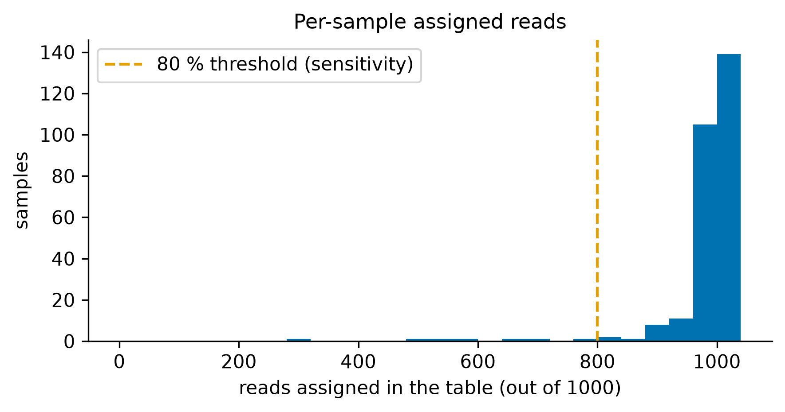
*Figure 1. Reads assigned in the table per sample (out of 1000). The deficit is kept as an explicit `Unassigned` category; samples below the dashed line (80 %) are used in a sensitivity analysis.*

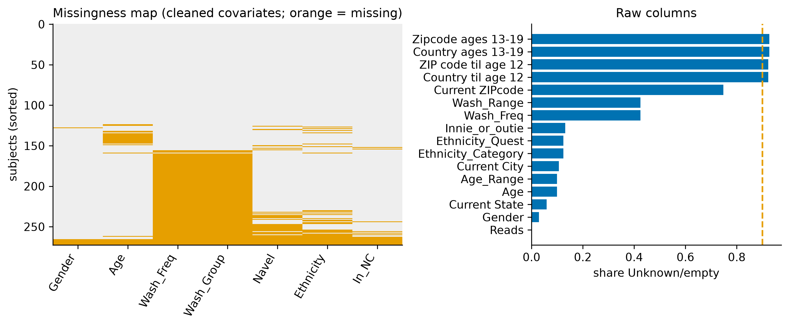
*Figure 2. Left: missingness of the cleaned covariates (orange = missing; subjects sorted by number of missing fields). Right: share of `Unknown` or empty values in the raw columns; columns above 90 % (dashed line) were dropped.*

### 2.3 Analysis matrices

Three count matrices are used, each with rows summing to 1000:

1. **All labels** (585 + `Unassigned`): used for descriptive statistics.
2. **Filtered** (112 taxa with prevalence ≥ 10 % + `Other` + `Unassigned`): used for the exploratory analysis. The 10 % threshold was fixed before modelling. Appendix B shows that it moves on average 3.3 % of reads into `Other`, versus 0.4 % at a 2 % threshold and 13.5 % at 30 %.
3. **Modelling matrix** (the 20 most abundant taxa + `Other` + `Unassigned`, D = 22 categories): used for all models, validation and the power study. The 20 taxa carry 78.7 % of the reads. The reason for this resolution is given in Section 3.3.

---

## 3. Methods

Notation: sample *i* has a count vector **x**ᵢ = (x_i1, …, x_iD) with Σⱼ x_ij = N = 1000, and **p**ᵢ is its vector of underlying proportions. Matrices are samples × categories.

### 3.1 Compositional data

Because the library size is fixed by the sequencing run, only relative abundances are observed. The data live on the simplex, and only ratios between parts carry information (Aitchison 1982, 1986; Gloor et al. 2017). Log-ratio transforms map compositions to real space:

- **centred log-ratio:** clr(**x**)ⱼ = log xⱼ − (1/D) Σₖ log xₖ;
- **additive log-ratio:** alr(**x**)ⱼ = log(xⱼ / x_D).

The **Aitchison distance** is the Euclidean distance between CLR vectors. Zeros make logs undefined. For descriptive distances and for the per-taxon tests of Section 3.5, a pseudocount of 0.5 reads is added. Its influence was checked: the Spearman correlation of all pairwise Aitchison distances across pseudocounts 0.1, 0.5, 1 and 2 is at least 0.89. The generative models need no pseudocount, because zeros arise naturally from multinomial sampling.

### 3.2 Generative models

| Model | Definition | Free parameters (D = 22) |
|---|---|---|
| **M0** multinomial | **x**ᵢ ~ Multinomial(N, **p**), one **p** for all samples | D − 1 = 21 |
| **M1** Dirichlet-multinomial | **p**ᵢ ~ Dirichlet(**α**), **x**ᵢ ~ Multinomial(N, **p**ᵢ) | D = 22 |
| **M2** DM regression | log α_ij = bⱼ + **z**ᵢ·**β**ⱼ for the 10 most abundant taxa, βⱼ = 0 otherwise | D + 10·q |
| **M3** logistic-normal multinomial | **z**ᵢ ~ N(**μ**, **Σ**) in ALR coordinates (reference `Other`), **p**ᵢ = softmax([**z**ᵢ, 0]) | 21 + 231 (Σ shrunk) |
| **M4** zero-inflated M3 | taxon *j* absent with probability πⱼ; present taxa share reads as in M3 | M3 + 21 (calibrated) |

**M0 → M1.** Under M0 each count is binomial with Var x_ij = N pⱼ(1 − pⱼ). The DM keeps the mean but multiplies every variance by the same factor 1 + (N − 1)ρ, with ρ = 1/(1 + A) and A = Σⱼ αⱼ. Its log-likelihood is closed-form:

log P(**x** | **α**) = log N! − Σⱼ log xⱼ! + ln Γ(A) − ln Γ(N + A) + Σⱼ [ln Γ(xⱼ + αⱼ) − ln Γ(αⱼ)].

The DM is the standard overdispersed model for microbiome counts (Holmes et al. 2012; La Rosa et al. 2012).

**M2.** Covariates (age and washing frequency standardised; male and outie as 0/1 indicators) shift log αⱼ for the 10 most abundant taxa. This is a simplified version of the DM regression of Chen and Li (2013), with D + 10q instead of D(q + 1) parameters. exp(βⱼ) multiplies the expected ratio of taxon *j* to any taxon without covariate effects.

**M3.** A Gaussian on ALR coordinates (Aitchison 1986; Xia et al. 2013) gives each taxon its own variance and allows positive as well as negative correlations between taxa. The multinomial step then draws the reads.

**M4.** Added after the first validation round showed that M3 produces too few zeros (Section 4.3). A taxon can be structurally absent from a person, as in zero-inflated simulators such as SparseDOSSA (Ma et al. 2021).

### 3.3 Estimation and model comparison

**Maximum likelihood.** M0 has the closed form p̂ⱼ = Σᵢ x_ij / Σᵢ N. M1 and M2 are fitted by L-BFGS on log α with analytic gradients (checked against finite differences in the test suite).

**M3: likelihood and fitting.** The M3 likelihood log ∫ Mult(**x** | softmax **z**) N(**z** | **μ**, **Σ**) d**z** has no closed form.

- **Laplace approximation.** It is approximated by a second-order expansion of the integrand around its maximum (a saddle-point approximation):

  log p(**x**) ≈ f(**ẑ**) − ½ log det **Σ** − ½ log det **H**(**ẑ**),

  where f is the log-integrand without normalising constants and **H** its negative curvature.
- **Fitting.** **μ** and **Σ** are estimated by an approximate EM algorithm. The E-step uses the Laplace Gaussian for each sample. The M-step updates **μ** and **Σ**, and **Σ** is shrunk towards its diagonal, **Σ** = (1 − λ)**S** + λ diag(**S**). λ is chosen by cross-validation from {0.005, …, 0.7}.

**Choice of resolution.** The Laplace approximation was checked against importance sampling (IS) with the Laplace Gaussian as proposal (Table 1, Figure 3).

- **D = 114 (all filtered taxa):** the two disagree by up to 2.5 nats per sample, and IS keeps an effective sample size of only about 5 out of 20 000 draws. Neither number can be trusted there, because the zero counts make the integrand strongly skewed.
- **D = 22:** they agree to within 0.25 nats, with more than 2000 effective draws.

All models are therefore compared on the D = 22 matrix. This decision was taken before any model comparison was run. M0 and M1, whose likelihoods are exact, are also compared at full resolution.

*Table 1. Accuracy of the Laplace approximation of the M3 likelihood (15 random samples, 20 000 IS draws).*

| D | median abs(Laplace − IS) | max abs(Laplace − IS) | median ESS | min ESS |
|---|---|---|---|---|
| 7 | 0.03 | 0.13 | 11 806 | 3 363 |
| 12 | 0.09 | 0.13 | 7 339 | 2 143 |
| **22** | **0.13** | **0.25** | **3 031** | **2 210** |
| 32 | 0.09 | 0.62 | 1 244 | 677 |
| 114 | 0.88 | 2.46 | 5 | 1 |

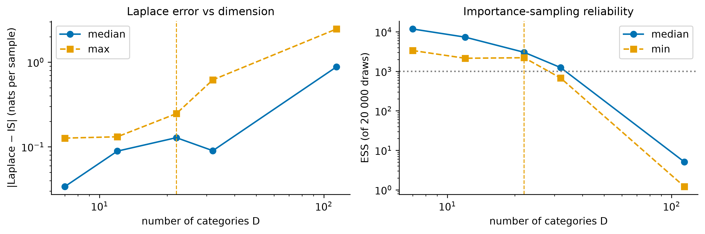
*Figure 3. Laplace error (left) and importance-sampling effective sample size (right) as a function of the number of categories D. The dashed line marks the chosen D = 22.*

**Comparison criteria.** The main criterion is the **held-out log-likelihood per sample** from 5-fold cross-validation with a fixed seed. Each model is fitted on four folds and scores the log-probability of the unseen fifth. For M3 the held-out values use IS with 10 000 draws (smallest effective sample size over all held-out samples: 28). Differences between models are **paired**: same samples, standard error of the per-sample differences. AIC = 2k − 2ℓ̂ and BIC = k ln n − 2ℓ̂ are reported where they are valid (M0–M2). They are not valid for M3, whose likelihood is approximate and whose shrinkage makes the effective number of parameters unclear. M1 is nested in M2 (all **β** = 0), so a likelihood-ratio test LR = 2(ℓ̂_M2 − ℓ̂_M1) ~ χ²_df is also used. Parameter uncertainty comes from a non-parametric bootstrap over subjects: 500 refits for M1 and M2, 100 for M3.

### 3.4 Validation of the simulators

From each fitted model, R = 200 datasets with the real design (273 samples × 1000 reads) were simulated.

**Summary statistics.** Nine statistics were computed: zero share, mean richness, mean and standard deviation of Shannon entropy, mean Gini–Simpson index, median share of the dominant taxon, median and 10 % quantile of pairwise Bray–Curtis dissimilarity, and the Taylor's-law slope (Taylor 1961).

- **Parametric bootstrap:** the 95 % band of each statistic over the simulated datasets shows what the model can produce.
- **Non-parametric bootstrap over subjects:** gives the 95 % CI of the real value. For the pairwise Bray–Curtis statistics, pairs of a subject with its own copy were excluded.

A model "reproduces" a statistic when the real value lies inside its band.

**Distributions.** Shannon, Simpson and richness per sample, and pairwise Bray–Curtis, were compared by two-sample Kolmogorov–Smirnov tests (per-sample metrics only) and by the Wasserstein distance. The Wasserstein distance was calibrated with the parametric bootstrap: its distribution when the model is true gives a Monte Carlo p-value.

**Indistinguishability.** Real and simulated samples were pooled and tested with PERMANOVA (Anderson 2001) and PERMDISP (Anderson 2006), repeated for 20 simulated datasets. R² is the effect size; a good simulator gives R² ≈ 0.

**Decision rules, fixed before running:**

1. Among the likelihood-based models, the best-CV model is the final simulator unless another reproduces more statistics.
2. M4, added after round 1, becomes the primary simulator only if it reproduces at least as many of the 7 statistics it was not calibrated on **and** its PERMANOVA R² is not larger than M3's for both distances.

**M4 calibration (method of moments).** πⱼ and the ALR mean μⱼ were tuned so that, per category, the expected prevalence and expected mean count equal the real ones. This uses the exact expectations P(xⱼ > 0 | **p**) = 1 − (1 − pⱼ)^N and E xⱼ = N pⱼ, with common random numbers, and **Σ** is kept from M3. Zero share and mean richness are matched by construction, so they are excluded from M4's validation.

### 3.5 Seasonal power study

The design was written down and frozen (SHA-256 of the plan file recorded) **before** any power result was computed. The notebook refuses to run if the frozen part of the plan changes (Appendix D). The full plan is in `report/analysis_plan_phase4.md`.

**Scenario.** Each simulated study has one sample per subject, with months balanced (n/12 subjects per month), like a cross-sectional design. The driver is s(m) = cos(2π(m − 7)/12), peaking in July. For *K* of the 20 named taxa, chosen at random in every study, the ALR coordinate is shifted by A·s(m)·signⱼ, with signs alternating (+, −, +, …) so that some taxa peak in summer and some in winter. The peak-to-trough fold change relative to `Other` is e^{2A}. Counts are drawn from M3, with M4 as a sensitivity analysis (Figure 4).

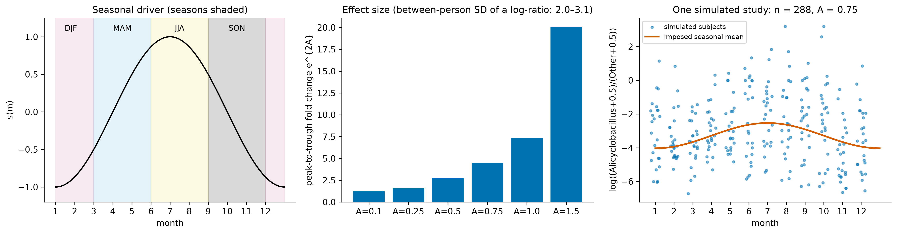
*Figure 4. Left: seasonal driver with the four seasons used by PERMANOVA. Middle: fold change for each amplitude; the between-person SD of a log-ratio in the fitted model is 2.0–3.1. Right: one simulated study (n = 288, A = 0.75); the orange curve is the imposed seasonal mean, the dots are individual subjects.*

**Grid (145 points, R = 1000 studies each).**

- **Main scenario:** M3, K = 3, 1000 reads, **Σ** × 1, over A ∈ {0, 0.1, 0.25, 0.5, 0.75, 1, 1.5} × n ∈ {48, 96, 192, 288, 384}. n = 288 is the multiple of 12 closest to the real study (273).
- **The same A × n grid with M4.**
- **One-at-a-time sensitivity** at n ∈ {96, 288}: K = 1 and K = 5; depth 10 000 reads; **Σ** × 0.5 and **Σ** × 2.
- **Negative control:** A = 1 with the month labels shuffled before testing.

**Detection tools** (pre-specified; 21 parts without `Unassigned`, CLR pseudocount 0.5; α = 0.05):

1. **PERMANOVA on Aitchison distance**, factor season (4 groups), 199 permutations. With 199 permutations the permutation test has exact level α = 0.05.
2. **PERMANOVA on Bray–Curtis** (Bray and Curtis 1957), same design.
3. **Per-taxon cosinor regression** (Cornelissen 2014) on the CLR of each named taxon, clr = b₀ + b₁ cos(2πm/12) + b₂ sin(2πm/12) + ε, with an F-test of b₁ = b₂ = 0 (2 df) and **Benjamini–Hochberg** control at q = 0.05 over the 20 taxa (Benjamini and Hochberg 1995). A study counts as a detection if at least one taxon is rejected.

**Outcomes.**

- **Power and type I error:** the rejection rate at A > 0 and at A = 0. Type I error is accepted if it lies within 0.05 ± 2·MCSE = [0.036, 0.064], where MCSE = √(p(1 − p)/R) is the Monte Carlo standard error (at most 0.016 for R = 1000).
- **Minimum detectable effect (MDE):** the smallest *A* with power ≥ 0.80, by linear interpolation.
- **Cosinor accuracy:** sensitivity per affected taxon and false discovery rate.
- **Reproducibility:** every replicate has its own seed [SEED, 5, point, replicate], so results do not depend on run order or on the number of parallel workers.

**Amendment.** One dated amendment was made after the first results (Appendix D). The pre-specified FDR (averaged over studies with at least one rejection) is the *positive* FDR, which Benjamini–Hochberg does not control. The standard FDR was therefore added, and both are reported. Nothing else changed.

### 3.6 Software and checks

Python 3.12 with numpy, scipy, pandas, statsmodels, scikit-learn, scikit-bio (diversity, PCoA, PERMANOVA reference), matplotlib and plotly, with versions pinned in `requirements.txt`. A single global seed (20261030) is used throughout. Sixteen assert-style tests check the logic that matters:

- **Parser:** the table end, that values are exact multiples of 1/1000, and that aggregation conserves counts.
- **Diversity:** alpha diversity against scikit-bio, and that CLR rows sum to 0.
- **DM:** probabilities sum to 1 over all count vectors; DM → multinomial as A → ∞; the simulated mean and variance match theory.
- **Fits:** maximum-likelihood fits recover known parameters, and the M2 gradient matches finite differences.
- **M3/M4:** the LNM Laplace value matches IS in low dimension, and the M4 calibration recovers known π.
- **Power code:** the fast PERMANOVA equals scikit-bio's pseudo-F; the permutation test and the cosinor test have type I error ≈ 0.05; the simulator imposes ±A exactly.

---

## 4. Results

### 4.1 Exploratory analysis of the real data

**Sparsity and dominance.** Over all 585 labels, 92.9 % of cells are zero. The median label occurs in 1.5 % of samples, and 70 % of labels occur in fewer than 5 % of samples. A few taxa dominate:

- *Corynebacterium* has a mean relative abundance of 23 % and the *Staphylococcaceae* bin 19.5 %;
- the 10 most abundant taxa carry 66 % of the reads;
- the median sample has 42 % of its reads in a single taxon.

This "oligarchy" agrees with Hulcr et al. (2012).

**Overdispersion.** On log–log axes, the variance of each taxon's count grows with its mean with a Taylor slope of b = 1.84 (bootstrap 95 % CI 1.82–1.89), where a multinomial predicts b = 1 (Figure 5). Every taxon has more than twice the multinomial variance, with a median of 22× (IQR 7–94×). This is the clearest signal in the data and rules out M0 before any fitting.

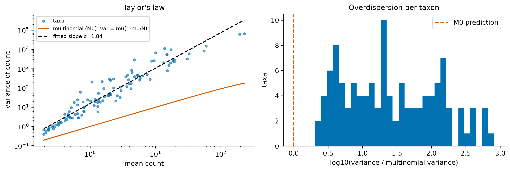
*Figure 5. Left: Taylor's law for the 113 filtered categories; orange = multinomial prediction, dashed = fitted power law. Right: variance relative to the multinomial variance per category (log scale).*

**Diversity.** Median richness is 30 labels (IQR 21–63), median Shannon entropy 1.91 nats (IQR 1.24–2.46) and median Gini–Simpson 0.75 (IQR 0.53–0.84). Richness decreases with age (Spearman ρ = −0.23, BH-adjusted p = 0.003) and differs by sex and navel type (adjusted p ≈ 0.02). Washing frequency shows no association.

Richness is strongly correlated with the number of assigned reads (ρ = −0.69). A plausible but unverified explanation is that the source table dropped rare taxa, so samples with many rare taxa lost more reads. Richness is therefore reported with this caveat, and Shannon and Simpson, which depend less on rare taxa, are preferred.

**Between-sample structure.** The median Bray–Curtis dissimilarity between two people is 0.79 (5–95 %: 0.34–0.98). In PCoA (Gower 1966) the first two axes explain 23 % and 21 % (Bray–Curtis) or 29 % and 9 % (Aitchison). The axes follow the gradients of the dominant taxa rather than any covariate (Figure 6). The Aitchison ordination shows an arch, a known geometric distortion along a dominant gradient, not a second signal.

In exploratory PERMANOVAs (12 tests, Benjamini–Hochberg corrected), age group (R² = 0.027 Bray–Curtis, 0.025 Aitchison; adjusted p = 0.003) and current residence in North Carolina (R² = 0.018 and 0.017; adjusted p = 0.003) were the only robust effects; sex was significant only under Aitchison (R² = 0.009, adjusted p = 0.034). **Covariates explain 0.4–3 % of the variation between people.**

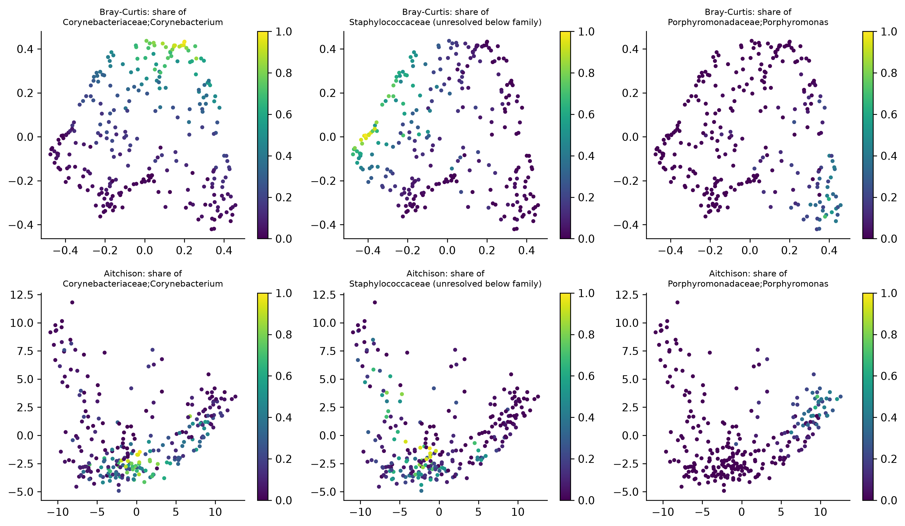
*Figure 6. PCoA of Bray–Curtis (top) and Aitchison (bottom) distances, coloured by the share of the three most abundant taxa. The ordination is organised by dominant taxa.*

### 4.2 Generative models (RQ1)

**Cross-validation.** Table 2 and Figure 7 give the held-out log-likelihood per sample.

- **M0** fails completely (−1074 vs −65 nats per sample for M1).
- **M3** improves on M1 by **7.3 ± 0.3 nats per sample** and is better for 91 % of the held-out samples.
- The M3 shrinkage curve is flat for λ ≤ 0.1, with an interior optimum at λ = 0.05. Choosing λ on the same folds adds a small optimistic bias, negligible against a 7-nat gain.
- **At full resolution (114 categories),** M1 also beats M0 by a wide margin (−167.4 ± 4.4 vs −1434 nats).

*Table 2. Model comparison on D = 22 (5-fold CV, held-out log-likelihood per sample; SE over samples; differences paired).*

| Model | CV log-likelihood | SE | Δ vs M1 | SE Δ | samples better than M1 | k | AIC | BIC |
|---|---|---|---|---|---|---|---|---|
| M0 multinomial | −1074.3 | 46.4 | −1009.0 | 46.8 | 0 % | 21 | 572 256 | 572 332 |
| M1 Dirichlet-multinomial | −65.3 | 1.0 | 0 | – | – | 22 | 35 651 | 35 730 |
| **M3 LNM, λ = 0.05** | **−58.0** | **0.9** | **+7.3** | **0.3** | **91 %** | 252 (nominal) | n/a | n/a |
| M3 LNM, λ = 0.7 | −60.4 | 1.0 | +4.9 | 0.2 | 90 % | 252 (nominal) | n/a | n/a |

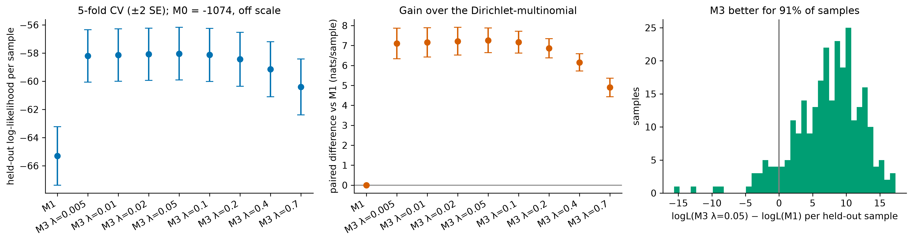
*Figure 7. Left: held-out log-likelihood per sample (± 2 SE). Middle: paired gain of M3 over M1 for each shrinkage λ. Right: distribution of the per-sample gain for λ = 0.05.*

**Why M3 wins.** The fitted DM has precision A = 4.82 (bootstrap 95 % CI 4.40–5.35), i.e. ρ = 0.172 (0.157–0.185). This inflates every category's variance by the same factor of 173, whereas the empirical ratio ranges from 34 to 821 across categories. One overdispersion parameter cannot describe taxa that differ this much. M3 gives each taxon its own variance (ALR standard deviations 2.0–3.1) and allows correlations between taxa (Figure 8).

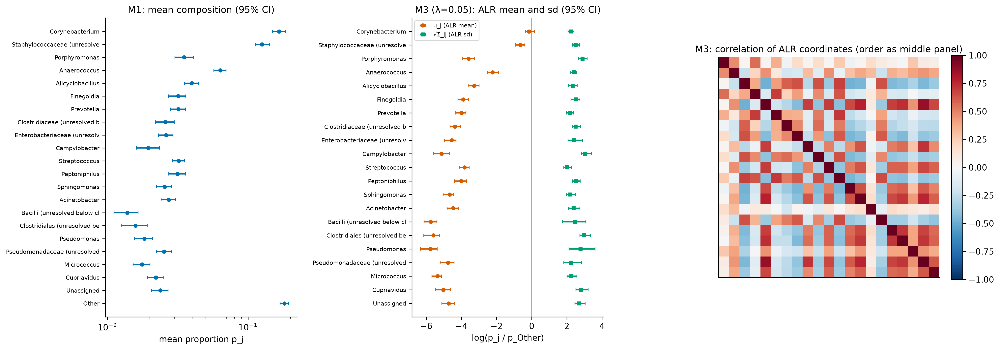
*Figure 8. Parameter estimates with 95 % bootstrap CIs. Left: M1 mean composition. Middle: M3 ALR means and standard deviations relative to `Other`. Right: M3 correlation matrix of ALR coordinates.*

**Covariates (M2).** Table 3 compares M2 with M1 refitted on the same complete cases. With age, sex and navel type (n = 217) the covariates are clearly significant in-sample (LR = 82 on 30 df, p < 10⁻⁶) and AIC prefers M2. BIC prefers M1, however, and cross-validation shows **no gain** (+0.04 ± 0.06 nats per sample). Adding washing frequency (n = 132) makes all criteria worse.

Of the 30 bootstrap CIs for exp(β), 8 exclude 1, against about 1.5 expected by chance (Figure 9). Older age is associated with relatively more *Corynebacterium* and less *Alicyclobacillus*, and being male with more *Staphylococcaceae* and *Alicyclobacillus*. The outie effects rest on only 16 outies.

The interpretation is that covariate effects exist but are small compared with person-to-person variation, so they do not help predict a new person's microbiome. The final simulator therefore does not include covariates.

*Table 3. M2 (DM regression) vs M1 on the same complete cases.*

| Variant | n | extra parameters | LR | p | ΔAIC | ΔBIC | CV Δ (M2 − M1) |
|---|---|---|---|---|---|---|---|
| age, sex, navel | 217 | 30 | 82.1 | 1.0 × 10⁻⁶ | −22.1 | +79.3 | +0.04 ± 0.06 |
| + washing frequency | 132 | 40 | 74.1 | 8.3 × 10⁻⁴ | +5.9 | +121.2 | −0.12 ± 0.10 |

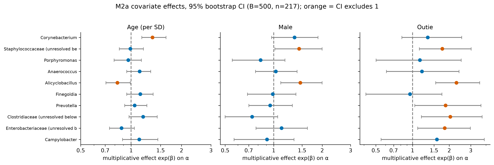
*Figure 9. M2 covariate effects exp(β) on α for the 10 most abundant taxa, with 95 % bootstrap CIs (B = 500). Orange: CI excludes 1.*

**Answer to RQ1.** The logistic-normal multinomial (M3) reproduces the real data best. Its advantage comes from taxon-specific variances and correlations, which a Dirichlet-multinomial cannot represent. Covariates enter as small shifts of the mean composition (M2) that are detectable in-sample but not useful for prediction.

### 4.3 Validation of the simulators (RQ2)

**Summary statistics.** Figure 10 and Table 4 compare the real statistics with the 95 % parametric bands.

- **M0** reproduces none of the nine statistics: it makes samples identical and has no zeros.
- **M1** reproduces none. It gets the zeros roughly right but makes samples far too similar: mean Shannon is 1.70 vs 1.35 real, and the SD of Shannon 0.28 vs 0.54.
- **M3** reproduces four: mean Shannon, mean Simpson, dominant share and the 10 % Bray–Curtis quantile. It is close on the SD of Shannon (0.46 vs 0.54) and the median Bray–Curtis (0.67 vs 0.70), but **produces too few zeros** (32 % vs 41 %) and therefore too high a richness (14.3 vs 12.6 of 21).

By decision rule 1, M3 is the final likelihood-based simulator.

*Table 4. Real statistic (95 % bootstrap CI) and 95 % parametric band of each model (R = 200). Bold = real value inside the band. † matched by construction for M4.*

| Statistic | Real (CI) | M1 band | M3 band | M4 band |
|---|---|---|---|---|
| zero share † | 0.41 (0.38–0.43) | 0.42–0.45 | 0.30–0.34 | **0.39–0.42** |
| mean richness (of 21) † | 12.6 (12.0–13.0) | 11.8–12.2 | 14.0–14.7 | **12.2–12.8** |
| mean Shannon | 1.35 (1.30–1.42) | 1.66–1.73 | **1.34–1.45** | **1.34–1.43** |
| SD Shannon | 0.54 (0.50–0.59) | 0.26–0.31 | 0.43–0.50 | 0.42–0.50 |
| mean Simpson | 0.60 (0.58–0.63) | 0.73–0.75 | **0.59–0.63** | **0.59–0.64** |
| median dominant share | 0.49 (0.44–0.52) | 0.35–0.38 | **0.47–0.53** | **0.46–0.52** |
| median Bray–Curtis | 0.70 (0.67–0.73) | 0.67–0.70 | 0.65–0.69 | **0.68–0.73** |
| 10 % Bray–Curtis | 0.36 (0.34–0.38) | 0.46–0.49 | **0.34–0.38** | 0.37–0.42 |
| Taylor slope | 1.08 (1.03–1.43) | 0.91–1.07 | 1.24–1.46 | 1.16–1.35 |

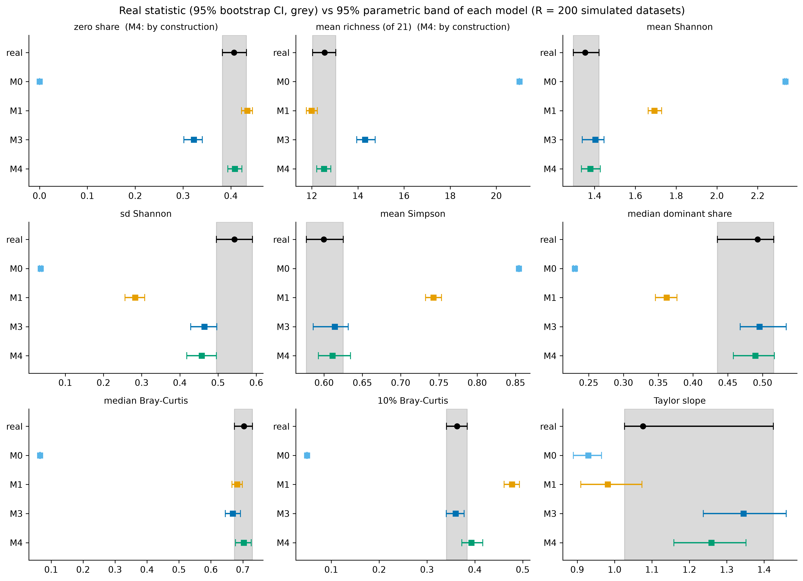
*Figure 10. Real statistic with 95 % bootstrap CI (black, grey band) against the 95 % parametric band of each model.*

**Distributions and indistinguishability.** M3 has the smallest Wasserstein distance to the real data for every metric (Shannon 0.07 nats, Simpson 0.03, Bray–Curtis 0.03), and its Shannon and Simpson distributions are not rejected by KS (p = 0.09 and 0.12). Calibrated against the parametric bootstrap, however, all Monte Carlo p-values remain below 0.05: with 273 samples, small differences are detectable.

When real and simulated samples are pooled, PERMANOVA attributes only R² = 0.0008 (Aitchison) and 0.0018 (Bray–Curtis) of the variation to the source for M3, significant in 0 % and 5 % of 20 repeats. For M1 the values are 0.002 and 0.014 (Bray–Curtis always significant), and for M0 0.04 and 0.11 (Figure 11). PERMDISP indicates a slight difference in spread for M3 (p ≈ 0.01).

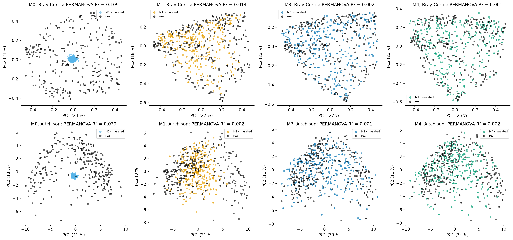
*Figure 11. Joint PCoA of real (black) and one simulated dataset (colour) for each model and distance, with the median PERMANOVA R² over 20 simulated datasets.*

**Zero-inflated M4.** The calibrated absence probabilities range from πⱼ = 0.006 (*Corynebacterium*, carried by almost everyone) to 0.52 (a *Bacilli* bin). The ALR means shift upwards to compensate for the absences.

On the 7 statistics M4 was not calibrated on, it ties with M3 (4 each): it gains the median Bray–Curtis and loses the 10 % Bray–Curtis quantile. It is better on several other checks:

- category variances inside the band: 77 % vs 64 %;
- PERMDISP p: 0.81 / 0.16 vs 0.014 / 0.012;
- Bray–Curtis distribution: Monte Carlo p 0.07 vs 0.01;
- PERMANOVA R² on Bray–Curtis: 0.0010 vs 0.0018.

Its Aitchison R², however, is slightly larger (0.0020 vs 0.0008). By the pre-set rule 2, **M3 therefore stays the primary simulator and M4 is the sensitivity analysis.** M4 looks better on most secondary checks, and switching after the fact would be exactly the kind of flexible choice the rule is meant to prevent.

**Sensitivity.** Removing the 7 samples with less than 80 % assigned reads leaves the conclusions unchanged: ρ changes from 0.172 to 0.173, and the CV gain of M3 over M1 is 7.1 ± 0.3 nats.

**Answer to RQ2.** M3-simulated data match the real data closely in diversity, dominance and between-sample dissimilarity, and are almost indistinguishable globally (R² ≤ 0.002). The remaining discrepancies are too few zeros and slightly too little spread in diversity. Adding structural zeros (M4) fixes the zeros at no cost to the other checks.

### 4.4 Seasonal power study (RQ3)

**Validity first.** With no seasonal effect (A = 0), all three tests reject at their nominal rate in every scenario: 3.5–6.3 %, with 58 of 60 rates inside the Monte Carlo acceptance band and the other two just below it, i.e. conservative (Figure 12). The negative control with shuffled labels gives 3.2–5.4 %; four of its 15 values are just below the band and none above. No scenario shows an inflated false-positive rate, so the power estimates below can be trusted.

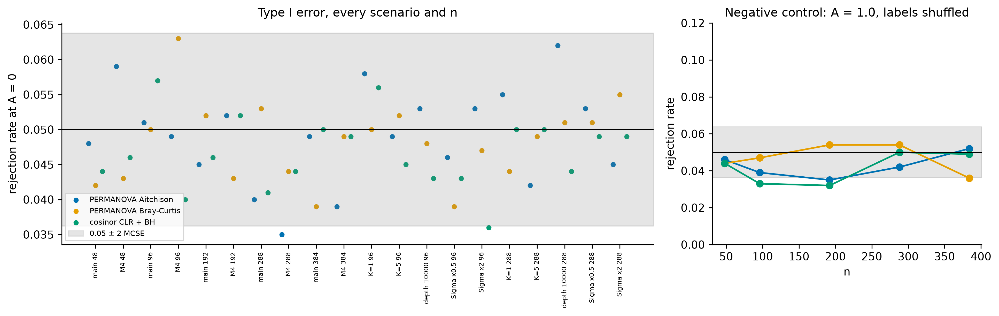
*Figure 12. Left: rejection rate at A = 0 for every scenario, n and test, with the band 0.05 ± 2 MCSE. Right: negative control (A = 1, month labels shuffled).*

**Power in the main scenario.** Figures 13 and 14 show power against amplitude and sample size, and Table 5 gives the minimum detectable effects.

- **Cosinor regression on CLR with Benjamini–Hochberg control is the most powerful tool** at every n. At n = 288 it reaches 80 % power at A = 0.66, a 3.8-fold peak-to-trough swing of the affected taxa relative to `Other`.
- **PERMANOVA on Aitchison distance** needs A = 1.05 (an 8-fold swing).
- **PERMANOVA on Bray–Curtis** never reaches 80 % on the grid (0.78 at n = 384, A = 1.5).
- At n ≤ 96 only very large effects (a fold change of 11 or more) are detectable.

*Table 5. Minimum detectable amplitude A at 80 % power (fold change e^{2A} in brackets); "–" = not reached for A ≤ 1.5.*

| n | Cosinor CLR + BH (M3) | PERMANOVA Aitchison (M3) | PERMANOVA Bray–Curtis (M3) | Cosinor (M4) | PERMANOVA Aitchison (M4) |
|---|---|---|---|---|---|
| 48 | – | – | – | – | – |
| 96 | 1.20 (×11) | – | – | 1.45 (×18) | – |
| 192 | 0.80 (×5.0) | 1.33 (×14) | – | 0.98 (×7.1) | 1.45 (×18) |
| **288** | **0.66 (×3.8)** | **1.05 (×8.1)** | – | **0.81 (×5.0)** | **1.24 (×12)** |
| 384 | 0.57 (×3.1) | 0.92 (×6.2) | – | 0.70 (×4.0) | 1.00 (×7.3) |

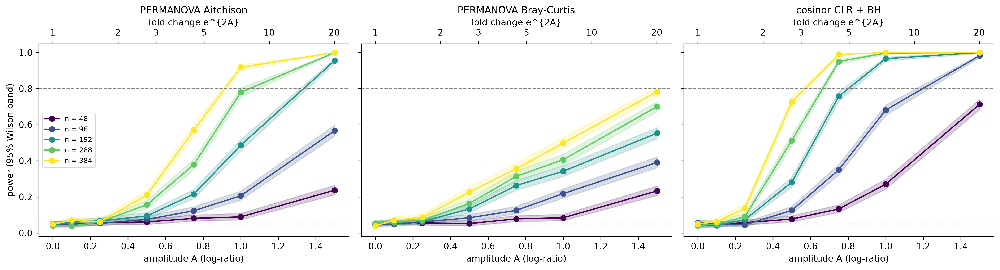
*Figure 13. Power against amplitude for each sample size (main scenario, 95 % Wilson bands, R = 1000). Top axis: fold change. Dashed: 80 %; dotted: 5 %.*

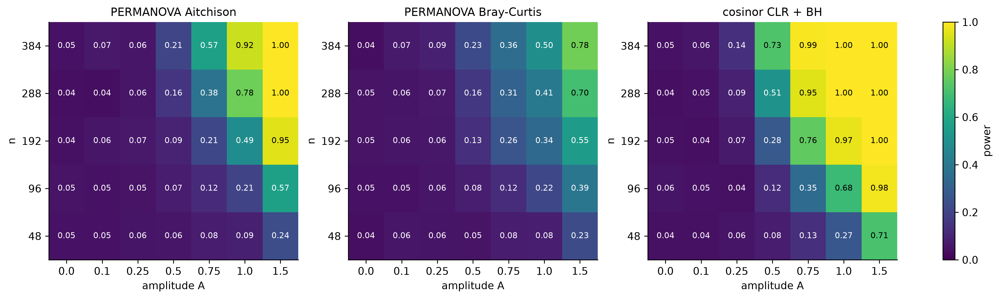
*Figure 14. Power over (A, n) for the three tools, main scenario.*

**Why the tools differ.** The cosinor test looks at each taxon separately and uses the shape of the imposed signal (2 degrees of freedom). PERMANOVA spreads the signal over all 21 parts, 18 of which carry none, and uses 4 season groups (3 degrees of freedom). Bray–Curtis is dominated by the most abundant taxa, which carry most of the between-person variation, while the randomly chosen affected taxa are often less abundant.

**Sensitivity analyses** (Figure 15, n = 96 dashed and n = 288 solid):

- **Number of affected taxa:** with K = 5, power rises (cosinor 0.72 vs 0.51 at A = 0.5, n = 288). With K = 1 it falls, and PERMANOVA becomes almost useless (0.20 at A = 1).
- **Between-person variation** matters most. Doubling **Σ** cuts PERMANOVA power at A = 1, n = 288 from 0.78 to 0.44; halving it raises it to 0.99.
- **Sequencing depth** barely matters. Ten times more reads changes power only slightly (cosinor 0.58 vs 0.51 at A = 0.5; PERMANOVA 0.73 vs 0.78 at A = 1), because counting noise is already small compared with biological variation.
- **Zero inflation (M4)** lowers power: minimum detectable effects are about 20 % larger.

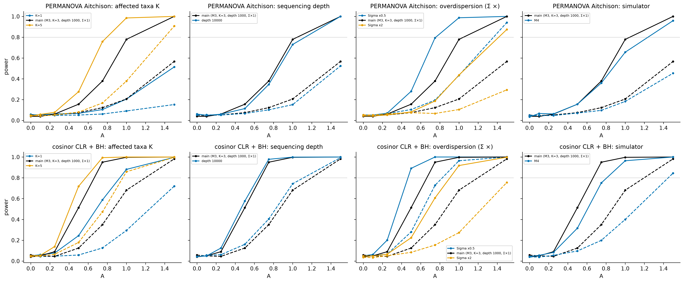
*Figure 15. Sensitivity of power to the number of affected taxa, sequencing depth, between-person variation and the simulator, for the two primary tools (black = main scenario).*

**Per-taxon accuracy.** Figure 16 shows the per-taxon sensitivity and false discovery rate of the cosinor procedure.

- **Positive FDR (pre-specified):** close to 1 at small amplitudes by construction. When there is almost no signal, the few studies that reject do so by chance.
- **Standard FDR (amendment 1),** the quantity Benjamini–Hochberg controls: 0.03–0.05 up to A = 0.75, rising to 0.06–0.07 for A ≥ 1 and n ≥ 192.

This small excess above q is a **compositional effect**. Shifting three taxa changes the geometric mean in the CLR, so every other taxon also acquires a small real seasonal signal in CLR space, and its rejections are counted as false. The literature predicts this side effect of closure (Gloor et al. 2017), and it should be expected in real seasonal analyses of relative abundances.

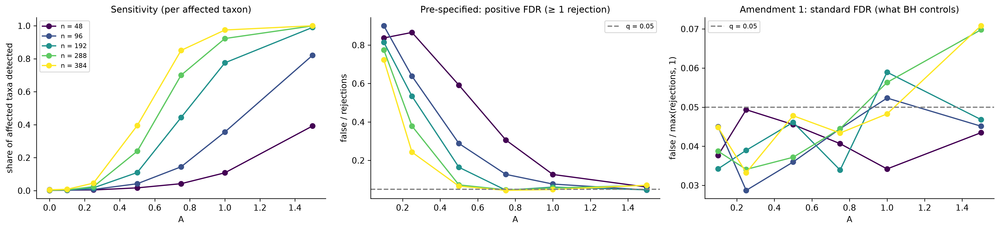
*Figure 16. Cosinor + BH, main scenario. Left: share of the affected taxa detected. Middle: pre-specified positive FDR. Right: standard FDR (amendment 1) with q = 0.05.*

**Answer to RQ3.** In a cross-sectional design the size of this belly-button study (n ≈ 288), a seasonal driver must swing the relative abundance of a few taxa by roughly fourfold between summer and winter before per-taxon cosinor regression detects it with 80 % power. Community-level PERMANOVA needs roughly an eightfold swing (Aitchison) or more (Bray–Curtis). Doubling n to about 400 lowers the detectable cosinor swing to about threefold. Smaller seasonal changes, such as the shifts reported for skin in small longitudinal studies, would very likely go undetected.

---

## 5. Discussion

### 5.1 Main findings

1. **The data need a model with taxon-specific overdispersion.** The multinomial is far from the data, and the Dirichlet-multinomial, the standard overdispersed model, fails because it forces one overdispersion factor on all taxa. The logistic-normal multinomial captures taxon-specific variances and correlations, and wins by about 7 nats per sample. This matches the motivation of Xia et al. (2013) for logistic-normal models.
2. **Simulated data from M3 are realistic but not perfect.** The main defect, too few zeros, is the expected weakness of a model whose zeros come only from sampling. A zero-inflated variant repairs it, which supports the use of zero-inflated components in recent simulators (Ma et al. 2021).
3. **Detecting seasonality in a cross-sectional skin study is hard.** Between-person variation is large (the SD of a log-ratio between people is 2–3, i.e. a factor of 7–20) and covariates explain only 0.4–3 % of it. A seasonal effect must therefore be large before it stands out. Per-taxon cosinor regression is clearly preferable to community-level PERMANOVA for a periodic signal. More sequencing depth does not help; more subjects do.

### 5.2 Comparison with the literature

The dominance of a few taxa agrees with the oligarchic pattern described by Hulcr et al. (2012), and the large between-person variation with Costello et al. (2009). The power results are consistent with simulation-based power frameworks for microbiome data (La Rosa et al. 2012; Kelly et al. 2015), which also find that power depends mostly on between-sample variability. Environmental communities have strong, repeatable seasonal cycles (Gilbert et al. 2012; LaMartina et al. 2021), but human skin appears largely stable over time (Oh et al. 2016), and reported skin seasonality comes from small longitudinal studies (Seo et al. 2023). Our results suggest that such modest effects could not be detected with a cross-sectional design of a few hundred people. A repeated-measures design, where each person serves as their own control, would remove most of the between-person variation and is the obvious recommendation.

### 5.3 Limitations

- **The seasonal signal is simulated.** Nothing here measures the real seasonality of navel bacteria. The answer is conditional on the assumed driver (a sinusoid with known 12-month period), on the number and choice of affected taxa, and on the simulator.
- **One cohort, cross-sectional design, provenance.** The data are one sample per person from one project, mostly from North Carolina. The exact processing of the table could not be verified, and it differs from the published analysis (Section 2.1).
- **Rarefied data.** The table was rarefied to 1000 reads before we received it. This discards information (McMurdie and Holmes 2014), and the depth sensitivity analysis uses simulated, not real, deeper data.
- **Reduced resolution.** Models and power study use the 20 most abundant taxa plus pooled categories (D = 22), because the M3 likelihood could not be evaluated reliably at full resolution. Seasonal effects in rare taxa are outside the scope.
- **Approximations.** M3 is fitted by an approximate (Laplace) EM with diagonal shrinkage, and its held-out likelihood relies on importance sampling. M4 is calibrated by moments, not fitted by maximum likelihood, so it has no CV score.
- **Missing covariates.** Washing frequency is missing for 42.5 % of subjects, not at random. Covariate models use complete cases only, and their conclusions apply to that subset.
- **Simplifications in the scenario.** Presence/absence is not seasonal under M4, there is no temperature covariate, months are balanced, and each subject contributes one sample.

### 5.4 What a real study should do

- Sample each person repeatedly across the year.
- Use per-taxon cosinor (or a mixed-model version of it) on log-ratios rather than community-level PERMANOVA.
- Expect and report the compositional side effects on false discovery rates.
- Fix the analysis plan before looking at the data, as was done here.

---

## 6. Conclusion

A logistic-normal multinomial model fitted to the belly-button data reproduces its sparsity, dominance, diversity and between-person dissimilarity far better than multinomial or Dirichlet-multinomial models. Simulated and real samples are almost indistinguishable, apart from a deficit of zeros that a zero-inflated variant repairs. Covariates have real but small effects that do not improve prediction.

Using this simulator under a frozen analysis plan, a seasonal effect on a few taxa must produce roughly a fourfold peak-to-trough change before a study of about 290 people detects it with 80 % power using the best of the standard tools, per-taxon cosinor regression with FDR control. PERMANOVA is much less sensitive, and sequencing depth matters little compared with between-person variation. These conclusions concern what *could* be detected; the seasonality itself was imposed by simulation.

---

## References

Aitchison, J. (1982). The statistical analysis of compositional data. *Journal of the Royal Statistical Society: Series B*, 44(2), 139–177.

Aitchison, J. (1986). *The Statistical Analysis of Compositional Data*. London: Chapman and Hall.

Anderson, M. J. (2001). A new method for non-parametric multivariate analysis of variance. *Austral Ecology*, 26, 32–46.

Anderson, M. J. (2006). Distance-based tests for homogeneity of multivariate dispersions. *Biometrics*, 62(1), 245–253.

Benjamini, Y., & Hochberg, Y. (1995). Controlling the false discovery rate: a practical and powerful approach to multiple testing. *Journal of the Royal Statistical Society: Series B*, 57(1), 289–300.

Bray, J. R., & Curtis, J. T. (1957). An ordination of the upland forest communities of southern Wisconsin. *Ecological Monographs*, 27(4), 325–349.

Chen, J., & Li, H. (2013). Variable selection for sparse Dirichlet-multinomial regression with an application to microbiome data analysis. *Annals of Applied Statistics*, 7(1), 418–442.

Cornelissen, G. (2014). Cosinor-based rhythmometry. *Theoretical Biology and Medical Modelling*, 11, 16.

Costello, E. K., Lauber, C. L., Hamady, M., Fierer, N., Gordon, J. I., & Knight, R. (2009). Bacterial community variation in human body habitats across space and time. *Science*, 326(5960), 1694–1697.

Davenport, E. R., et al. (2014). Seasonal variation in human gut microbiome composition. *PLoS ONE*, 9(3), e90731.

Efron, B. (1979). Bootstrap methods: another look at the jackknife. *Annals of Statistics*, 7(1), 1–26.

Gilbert, J. A., et al. (2012). Defining seasonal marine microbial community dynamics. *The ISME Journal*, 6(2), 298–308.

Gloor, G. B., Macklaim, J. M., Pawlowsky-Glahn, V., & Egozcue, J. J. (2017). Microbiome datasets are compositional: and this is not optional. *Frontiers in Microbiology*, 8, 2224.

Gower, J. C. (1966). Some distance properties of latent root and vector methods used in multivariate analysis. *Biometrika*, 53(3–4), 325–338.

Holmes, I., Harris, K., & Quince, C. (2012). Dirichlet multinomial mixtures: generative models for microbial metagenomics. *PLoS ONE*, 7(2), e30126.

Hulcr, J., Latimer, A. M., Henley, J. B., Rountree, N. R., Fierer, N., Lucky, A., Lowman, M. D., & Dunn, R. R. (2012). A jungle in there: bacteria in belly buttons are highly diverse, but predictable. *PLoS ONE*, 7(11), e47712.

Kelly, B. J., et al. (2015). Power and sample-size estimation for microbiome studies using pairwise distances and PERMANOVA. *Bioinformatics*, 31(15), 2461–2468.

La Rosa, P. S., et al. (2012). Hypothesis testing and power calculations for taxonomic-based human microbiome data. *PLoS ONE*, 7(12), e52078.

LaMartina, E. L., Mohaimani, A. A., & Newton, R. J. (2021). Urban wastewater bacterial communities assemble into seasonal steady states. *Microbiome*, 9. https://doi.org/10.1186/s40168-021-01038-5

Ma, S., et al. (2021). A statistical model for describing and simulating microbial community profiles. *PLoS Computational Biology*, 17(9), e1008913.

McMurdie, P. J., & Holmes, S. (2014). Waste not, want not: why rarefying microbiome data is inadmissible. *PLoS Computational Biology*, 10(4), e1003531.

Oh, J., Byrd, A. L., Park, M., Kong, H. H., & Segre, J. A. (2016). Temporal stability of the human skin microbiome. *Cell*, 165(4), 854–866.

Seo, J. Y., et al. (2023). Longitudinal study of the interplay between the skin barrier and facial microbiome over 1 year. *Frontiers in Microbiology*, 14, 1298632.

Taylor, L. R. (1961). Aggregation, variance and the mean. *Nature*, 189, 732–735.

Xia, F., Chen, J., Fung, W. K., & Li, H. (2013). A logistic normal multinomial regression model for microbiome compositional data analysis. *Biometrics*, 69(4), 1053–1063.

(All references were verified online; see `literature/literature_review.md` for the verification table and `literature/references.bib` for BibTeX.)

---

## Appendix A. Data-cleaning decision table

| Decision | Reason | Rows affected |
|---|---|---|
| Cut `taxonomy.csv` at the first row with an empty Kingdom cell (649 taxa) | trailing richness row, repeated header, side table and note are not data | 10 rows removed |
| Decimal comma → point; fractions × 1000 → integer counts (asserted exact) | data are rarefied to 1000 reads | all cells |
| Add `Unassigned` = 1000 − assigned reads | 48 samples sum to < 0.99; renormalising would invent reads | 134 samples with any deficit |
| Label each row by its deepest resolved rank; sum equal labels | `Other` / empty ranks mean unresolved; 120 duplicate keys | 649 → 585 labels |
| Keep taxa with prevalence ≥ 10 %, rest → `Other` | fixed before modelling; sensitivity in Appendix B | 585 → 112 taxa |
| Strip whitespace in all metadata columns | `Innie ` vs `Innie`, `NC ` vs `NC` | 10 |
| `Unknown` / empty → missing, no imputation | missing stays missing; complete cases with n reported | 1657 cells |
| Navel: case-fold to {Innie, Outie} | `innie` / `Innie ` / `Innie` are one label | 72 |
| Washing frequency: decimal comma → float | `3,5` → 3.5 | 7 |
| Keep washing frequency, drop washing range | range contradicts frequency in 2 rows; `none`/`None` differ only by case; 0 washes is a real value | 2 |
| Ethnicity: Latino → Hispanic; groups with n < 10 → Other; free-text ethnicity not used | small groups cannot be estimated | 55 |
| Geography: keep only "currently in North Carolina" | ZIPs ≥ 70 % missing and partly corrupt; countries in the state column | 257 |
| Drop columns with ≥ 90 % missing (ZIP and country before age 20) | no information | 4 columns |
| Drop `Reads` | constant 1000 | 1 column |

## Appendix B. Sensitivity of the prevalence filter

| Minimum prevalence | taxa kept | median reads in `Other` | mean share in `Other` | zeros in kept table |
|---|---|---|---|---|
| 2 % | 269 | 1 | 0.4 % | 85 % |
| 5 % | 177 | 3 | 1.2 % | 79 % |
| **10 % (used)** | **112** | **8** | **3.3 %** | **71 %** |
| 20 % | 66 | 25 | 6.1 % | 61 % |
| 30 % | 36 | 85 | 13.5 % | 50 % |

## Appendix C. Additional figures

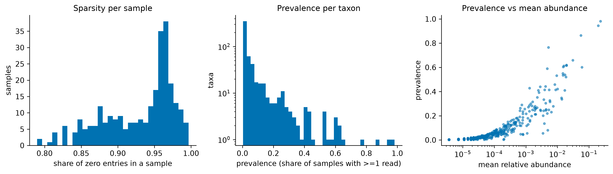
*Figure C1. Sparsity per sample, prevalence per taxon, and prevalence against mean relative abundance (all 585 labels).*

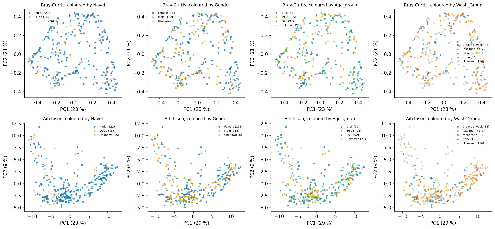
*Figure C2. PCoA coloured by navel type, sex, age group and washing group: no covariate organises the ordination.*

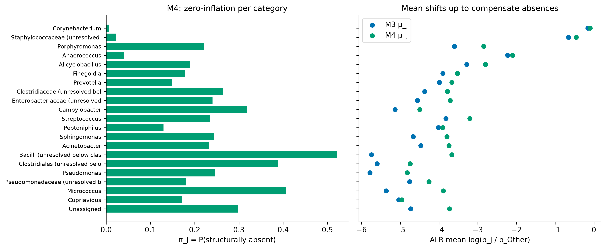
*Figure C3. M4 calibration: structural-absence probability per category and the shift of the ALR means relative to M3.*

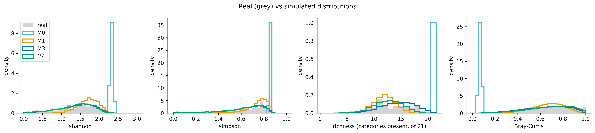
*Figure C4. Distributions of Shannon, Simpson, richness and pairwise Bray–Curtis: real data (grey) and pooled simulations of each model.*

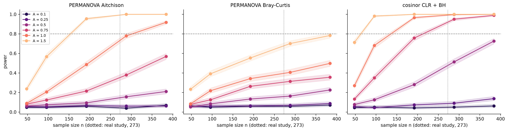
*Figure C5. Power against sample size for each amplitude (main scenario); dotted line: size of the real study.*

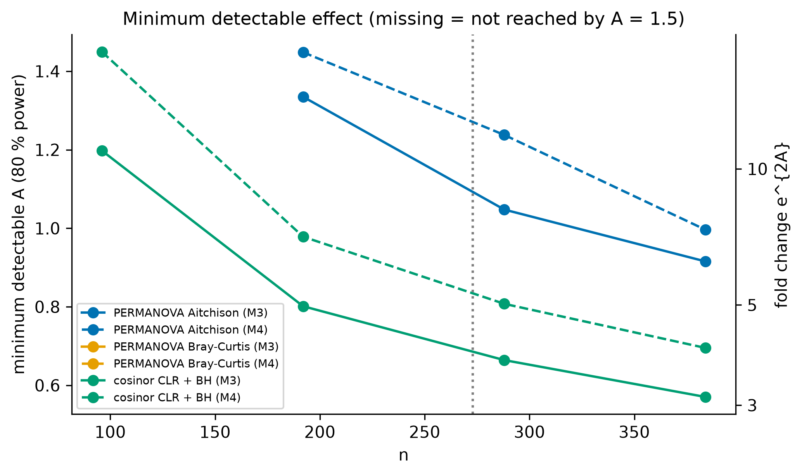
*Figure C6. Minimum detectable amplitude (80 % power) against sample size, for M3 (solid) and M4 (dashed).*

## Appendix D. Frozen analysis plan and amendment

The Phase 4 plan (`report/analysis_plan_phase4.md`) fixed the following before any power result was computed:

- the scenario;
- the grid of 145 points;
- the detection tools and thresholds;
- the outcomes;
- R = 1000 replicates;
- the seeding scheme and the reporting rules.

Its SHA-256 at freezing was `dfd32c3c…0285`. The notebook verifies the hash of the text above the "Amendments" heading (`53a474f0…d35d`) and stops if it changed.

One amendment was added after the first results. The pre-specified FDR (over studies with at least one rejection) is the positive FDR, which Benjamini–Hochberg does not control. The standard FDR was added and both are reported. No test, threshold, grid value or replicate changed, and the simulations were identical (same seeds).

## Appendix E. Where the numbers come from

| Numbers | File (in `data/processed/`) | Produced by |
|---|---|---|
| audit facts, decision table, filter sensitivity | `decision_table_env.csv`, `filter_sensitivity.csv` | `01_audit.ipynb` |
| sparsity, dominance, Taylor slope, diversity, PCoA, PERMANOVA | `eda_summary.csv`, `eda_permanova.csv`, `eda_alpha_tests.csv` | `02_eda.ipynb` |
| Laplace check, CV, AIC/BIC, M2 tests and coefficients | `model_laplace_check.csv`, `model_comparison*.csv`, `model_m2_*.csv` | `03_models.ipynb` |
| validation statistics, distributions, PERMANOVA, M4 calibration, final model, sensitivity | `valid_*.csv` | `04_validation.ipynb` |
| type I error, power, MDE, FDR, key numbers | `power_*.csv` | `05_power.ipynb` |

Reproduce everything with *Restart and Run All* of notebooks 01–05 in order (see `README.md`). The seed is fixed in `src/config.py`.
